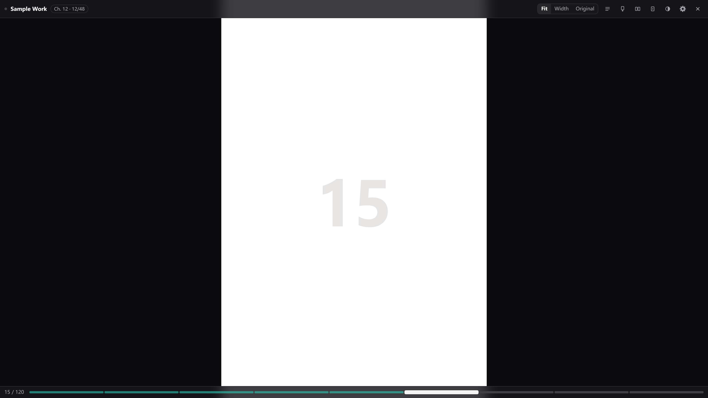
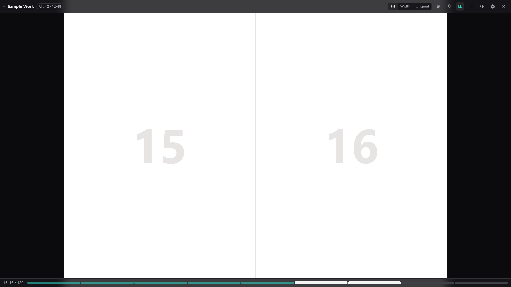
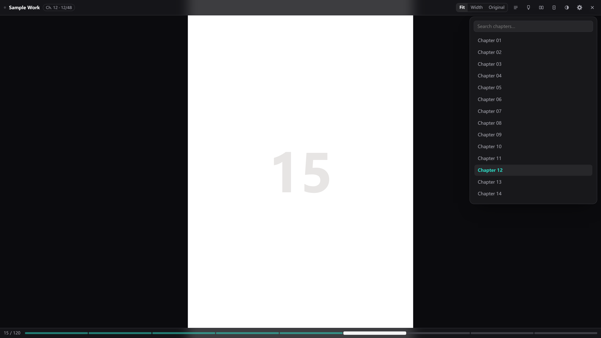

# Comic Viewer

A fuller-featured comic reader for a better reading experience: image preloading, seamless two-page spreads, chapter navigation, continuous webtoon scrolling, automatic chapter chaining, right-to-left manga order, zoom, and local caching.

The interface supports **中文 / English / 日本語 / 한국어**, switchable at any time in Settings.

> 中文说明：[README.md](README.md)

---

## Installation

1. **Install Tampermonkey**
   Search for and install the **Tampermonkey** extension from your browser's extension store.

2. **Add a new script**
   Once installed, click the Tampermonkey icon in the top-right corner of the browser and choose **Create a new script** to open the editor.

3. **Paste the script**
   Open **Comic Viewer.js** in this project, copy its contents in full, delete the default code in the editor, and paste what you copied into the Tampermonkey editor.

4. **Save the script**
   Press **Ctrl + S** (**Command + S** on Mac) to save, or click **"File" → "Save"** in the editor.

5. **Visit a supported site**
   After saving, open any supported site and the script will take effect automatically.

> Note: make sure the script is enabled and that your browser allows Tampermonkey to run on the relevant sites.

---

## Features

| Feature | Description |
|---|---|
| **Full-screen reading** | Images sit flush to the top and edges with no gaps, free of the site's sidebars and ad slots |
| **Chapter navigation** | List every chapter in one click, filter with a search box, highlight the current chapter and scroll it into view |
| **Automatic chapter chaining** | Keep turning past the last page of a chapter to go straight into the next one — no trip back to the table of contents |
| **Two-page spreads** | Two portrait pages joined into a single screen, with the second page on the left for manga reading order |
| **Webtoon mode** | Stack a whole chapter into one continuous vertical scroll, rolling into the next chapter at the bottom |
| **Preloading** | Downloads the next few pages ahead of time, so page turns are essentially instant |
| **Local cache** | Images are stored in the browser's local database, so revisits need no re-download |
| **Zoom & pan** | Zoom with the wheel or `+ -`, drag to pan when zoomed; supports viewing at original pixels |
| **Resume** | Remembers which chapter and page you were on, and picks up there next time |
| **Four UI languages** | 中文 / English / 日本語 / 한국어, following the browser language on first launch |

---

## Supported sites

- mangacopy
- e-hentai
- exhentai
- 18comic
- nhentai
- telegraph

(More sites will be added.)

> To add or remove supported sites yourself, edit the `@match` lines in this script (starting at line 10).
>
> **Note:** If you install this script via Greasy Fork, the built-in site support is incomplete. For full site support, follow these steps:
>
> 1. Open the Tampermonkey dashboard, click the script name, and go to "Settings".
> 2. Find "User matches", click "Add", and enter the site rules you need from [`list.js`](https://github.com/3Bringer/Comic-Viewer/blob/master/list.txt) one by one, for example: `https://telegra.ph/*`.
> 3. Save. These rules will be merged with the script's built-in matches and will not be overwritten when the script updates.
>
> If you want the script to run only according to these rules, uncheck "Original matches".

---

## Opening the reader

Two ways, same result:

- Click the **entry button** in the bottom-left corner (it reads "Read" on a title page and "View" on a reader page)
- Press **`V`**

From a **title page**: starts at chapter 1, page 1 (or resumes where you left off if you've read it before).
From a **reader page**: starts at page 1 of the current chapter; on E-Hentai, which uses one URL per page, it starts from the page you're currently viewing.

---

## Interface at a glance

*Single-page reading: the top bar holds the title, chapter and three scaling modes; the bottom bar shows the page number and progress.*

### Top bar (collapsed by default — click the center of the screen to show / hide)

From left to right:

| Element | Function |
|---|---|
| Title | The work's title |
| Chapter chip | Current chapter name + chapter number / total (shown only for multi-chapter works) |
| **Fit / Width / Actual** | Three scaling modes, see below |
| Contents icon | Open the chapter list |
| Webtoon icon | Toggle webtoon mode (shortcut `W`) |
| Spread icon | Toggle two-page mode (shortcut `S`) |
| Single-step icon | Single-page step calibration (shortcut `1`) |
| Theme icon | Dark / light interface (shortcut `T`) |
| Gear | Settings panel |
| × | Close the reader (`Esc`) |

**The three scaling modes:**

- **Fit**: scales the whole group of images to just fill the viewport without cropping. Long images (webtoons) are only scaled down, never up — narrower than the screen means centered with margins.
- **Width**: fills the screen width and will scale up, so you see less per screen.
- **Actual**: displays at the image's original pixels; scrollbars appear if it doesn't fit, and you can drag the view with the mouse.

### Bottom bar

- Left: **page number**, e.g. `15–16 / 120` (two pages are shown in spread mode)
- Right: **progress bar**. Each cell is one page; cached cells are darker, and you can click any cell to jump there.
  Chapters longer than 240 pages switch to a single continuous progress bar.

### Two-page spreads

*Two-page mode: pages 15 and 16 joined into one screen, with the bottom bar reading `15–16`.*

### Chapter list

*Chapter panel: the search box filters as you type, and the current chapter is highlighted and scrolled into view.*

### Mouse / touch

- Click the **left third** of the screen: previous page; the **right third**: next page; the **center**: show / hide the toolbar.
- Left and right can be swapped in Settings ("Tap to turn (next)").
- When zoomed in, press and drag to pan.
- The wheel turns pages by default, and can be changed to zoom.

---

## Keyboard shortcuts

| Key | Function |
|---|---|
| `→` / `L` | Next page (reversed if you swapped directions) |
| `←` / `H` | Previous page |
| `Space` / `PageDown` | Next page |
| `Shift+Space` / `PageUp` | Previous page |
| `[` / `]` | Previous / next chapter |
| `C` | Open / close the chapter list |
| `W` | Toggle webtoon mode |
| `S` | Toggle two-page mode |
| `1` | Toggle single-page step (for calibration) |
| `F` | Cycle Fit → Width → Actual |
| `+` / `=` | Zoom in |
| `-` / `_` | Zoom out |
| `0` | Reset zoom to 100% |
| `T` | Toggle dark / light |
| `M` | Show / hide the toolbar |
| `Esc` | Close the panel first; if no panel is open, exit the reader |
| `V` | Launch when the reader is closed |

---

## Settings

Open with the gear in the top bar. Every setting is remembered and reused next time.

| Setting | Default | Description |
|---|---|---|
| **Language** | Follow browser | 中文 / EN / 日本語 / 한국어 |
| **Webtoon mode (continuous scroll)** | Off | Lays the whole chapter out as one continuous scroll; mutually exclusive with two-page mode — enabling one turns the other off |
| **Two-page mode** | Off | Joins two portrait pages into one screen |
| **Manga order (2nd page on the left)** | On | Spread mode only. Manga reads right to left, so the second page sits on the left |
| **Preload pages** | 4 (1–8) | Don't set this too high — some sites may block your IP because of it |
| **Cache limit (pages)** | 120 (2–500) | How many images to keep locally; the **oldest** are evicted once you exceed it |
| **Image cache** | On | When off, nothing is stored locally and every page is fetched from the network |
| **Cached / Clear cache** | — | Shows current usage (files · size) and lets you clear it in one click |
| **Tap to turn (next)** | Right | Which side advances to the next page. Switch to "Left" if you're used to moving forward on the left |
| **Single step (pairing)** | Off | See "When the spread doesn't line up" below |
| **Mouse wheel** | Turn / Zoom | Can be changed to "Zoom". The wheel then zooms directly; turn pages with the keyboard or by clicking |

### When the spread doesn't line up

- **Single step (pairing)**: when enabled, each page turn advances exactly one page, so you can step through and find the right starting point. Turn it off once you've found it and carry on turning by spreads.

---

## Webtoon mode

Made for vertical-strip comics.

- When enabled, the whole chapter is stacked into one column and scrolls continuously, just like the site's own reader page.
- Scroll near the bottom and the **next chapter** is appended automatically — no manual chapter switching.
- The page-turn keys become "scroll down one screen".

> Webtoon mode lays out the entire chapter at once (images are still loaded on demand), so very long chapters (hundreds of pages) use noticeably more memory. If it stutters, switch back to single-page mode or lower the **Cache limit (pages)**.

---

## Cache and local data

The script stores things only in your browser locally — **nothing is uploaded to any server**.

| What | Where | Notes |
|---|---|---|
| Image bytes | IndexedDB `cmv-images` | Keys are image URLs **with the `?` query string stripped**, so links carrying time-limited tokens still hit the cache |
| Reading progress | localStorage `cmv:pos:*` | Which page you're on in each chapter |
| Chapter list | localStorage `cmv:list:*` | Expires after 12 hours, then re-fetched |
| Settings | localStorage `cmv:config` | All the settings above |

---

## FAQ

**Q: There's no button in the bottom-left corner?**
- Make sure the current page is a title page, gallery page, or reader page — not a search or home page.
- Refresh the page once.
- Check that the script isn't disabled in your userscript manager.

**Q: The reader opens but shows a blank screen?**
Usually the chapter list failed to load (a site redesign, or the page hadn't finished loading). Wait for the page to load fully and press `V` again.

**Q: Does it work on mobile?**
Not yet.

**Q: Will it interfere with the site's own features?**
The reader is a layer drawn over the page — close it and everything is back to normal. The script only intercepts navigation keys such as the arrow keys and space, so the page doesn't scroll while you turn pages.

---

## Permissions

The script header declares two permissions you should know about:

- `@grant GM_xmlhttpRequest` + `@connect *`
  Used to download images cross-origin and write them into the local cache. **It only requests the image URLs the site itself provides**, and sends data nowhere else.

- The script collects and uploads no personal information. No analytics, no remote configuration, no ads.

---

## License

MIT License. Free to use, modify, and redistribute — just keep the original author's attribution.
